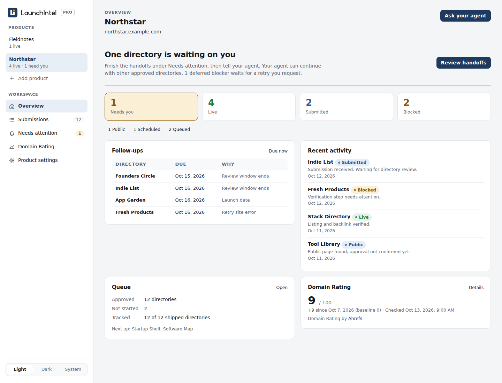

# LaunchIntel

Let Claude work through your product's launch, with tested playbooks and a local dashboard.

This is the public installer skill. The paid **LaunchIntel Pro** repository contains the
workflows, playbooks, templates, scripts and dashboard. Directory submissions are the first
module. Installing this skill alone does not provide the paid package or grant access to it.

[See the product and a sample guide](https://launchintel.dev)



## Install

You need Claude Code, Git, Node 20 or newer and a GitHub account. The private package also needs
a browser Claude can control; its setup guide explains the options.

Install the public skill whenever you like; using the paid workflows requires purchasing access
and connecting your GitHub account through Polar’s customer portal, then accepting the private
repository invitation. The portal link is in your Polar order confirmation:

```bash
git clone https://github.com/launchintel/launchintel.git ~/.claude/skills/launchintel
```

If that destination already exists, inspect it before updating; do not overwrite it.
Start a Claude Code session and say:

> Use LaunchIntel to launch my product.

Claude finds your existing private clone or helps clone it using your GitHub authentication,
then loads the workflow from there. You approve the product facts and queue before submissions
begin. In the paid workflow, you can exclude badges and choose whether blockers should wait for
your help or be deferred while Claude continues.

To inspect an existing private clone without logging in, changing files or running a workflow:

```bash
node ~/.claude/skills/launchintel/scripts/inspect-package.mjs /path/to/launchintel-pro
```

The check lists the installed modules and their private entrypoints. It does not print customer
run data. An unsupported package version or unsafe path stops setup before any workflow is read.

Authentication happens through your Git tools. Never paste passwords, tokens or keys into chat.
An access error can mean an unaccepted invitation or the wrong GitHub account; it does not
necessarily mean you need to purchase again.

## What is public

This skill, installation instructions and the example screenshot. The paid guides, directory
data, detailed workflow instructions and dashboard code are kept in a separate private repo.
Your product details, accounts and submission history stay on your own machine.

You can use this public repo for setup issues and feature requests. Do not attach private
playbooks, customer data, credentials or order details to public issues.

## Updates

With a clean public skill checkout, run:

```bash
git -C ~/.claude/skills/launchintel pull --ff-only
```

Update the paid package using its own README. Its workflow is read from the private clone each
time, so paid changes do not need to be copied into this public repo.

## Publishing this repo

The official repositories are `launchintel/launchintel` (this public installer) and
`launchintel/launchintel-pro` (the private paid package). Before publishing, run
`node scripts/check-public.mjs --release`.
Run `node --test tests/*.test.mjs` to check the installer against synthetic fixtures.
The release check limits this repo to the public files listed in the checker. Do not copy the paid repo
or its Git history here. Repository visibility and any software licence are separate decisions;
the paid package remains subject to its purchase terms.
